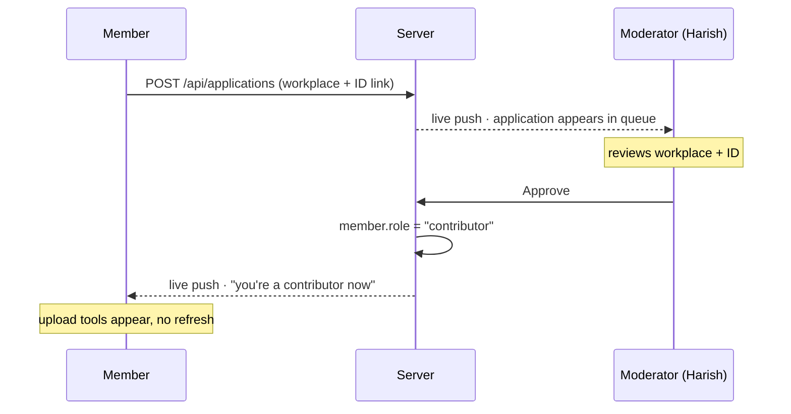
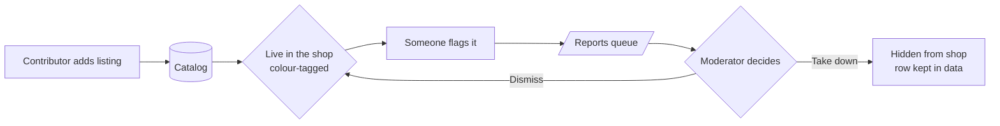
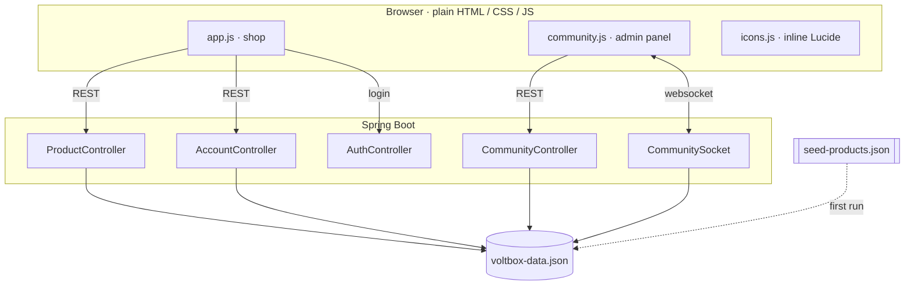

# Voltbox — Product Requirements

> A community price catalog for IT & electrical parts.
> Spring Boot + plain HTML/CSS/JS · one JSON file, no database · 150 parts across 18 categories.

*(There's a nicely rendered version of this document too — but everything is here in plain
markdown so it travels with the code. The diagrams below render on GitHub and in most editors.)*

---

## 1 · What Voltbox is, and the problem it solves

Prices for IT and electrical parts are scattered, inconsistent, and often out of date. A
resistor kit, a specific GPU, a network switch — the "real" price depends on who you ask and
when. Voltbox turns that into a **community reference**: the people who actually buy this gear
for a living maintain the numbers, so the catalog stays honest.

It ships useful on day one with **150 real parts** across CPUs, GPUs, memory, storage,
networking, sensors, tools and more — then grows as contributors add their own listings. For a
regular visitor it still behaves like a clean little shop: browse, add to a cart, check out, and
get a printable (or emailed) receipt.

**Design principle.** Every file is meant to be read end to end. Storage is a single
human-readable JSON file, there's no build step on the front end, and where something is
demo-level (plaintext passwords, non-expiring tokens) the code and docs *say so plainly* rather
than pretending otherwise.

---

## 2 · Three roles

Everyone who signs in is one of three things. Which one you are decides what the app lets you do
— and that decision is always made on the **server**, never trusted from the browser.

| Capability | Member | Contributor | Moderator |
|---|:---:|:---:|:---:|
| Browse catalog, cart, checkout, bills | ✓ | ✓ | ✓ |
| Apply to become a contributor | ✓ | — | — |
| Add & manage listings | — | ✓ | ✓ |
| Report a listing | — | ✓ | ✓ |
| Review & approve applications | — | — | ✓ |
| Grant contributor access directly | — | — | ✓ |
| Take down any listing / resolve reports | — | — | ✓ |

- **Member** — anyone who signs up; the default.
- **Contributor** — an approved member, tagged with a personal colour on their listings.
- **Moderator** — Harish only, the "voltbox head", seeded on first run. There is only ever one,
  and nobody can sign up as one.

---

## 3 · Becoming a contributor, in realtime

Contributing is gated so the catalog stays trustworthy. A member submits where they work in IT
plus a link to their work ID; the moderator approves or declines. The exchange happens live over
a websocket — the application lands in the moderator's queue the instant it's sent, and the
applicant's screen flips to contributor tools the moment it's approved. **Neither side refreshes**
— and because the app re-checks each visitor's role with the server on every load (live `/api`
data is never cached), a plain refresh reflects the change too.

The moderator can also skip the queue and grant contributor access by email — for people he
already trusts.

---

## 4 · Contributing & moderating listings

A contributor adds a listing (title, price, category, description, optional image) and it appears
in the shop immediately, colour-tagged by author. Any contributor can flag a bad listing; flags
land in the moderator's reports queue, where he takes the listing down or dismisses the report.

A taken-down listing isn't deleted — its row stays so past bills and reports still make sense;
it's just hidden from the shop.

---

## 5 · Architecture

A plain browser front end talks to a Spring Boot back end over REST, plus one long-lived
websocket for the realtime bits. Everything the server knows lives in a single JSON file that
`Store.java` reads and writes.

---

## 6 · One file holds everything

No database. On first run the file is created with the moderator account and the 150 built-in
listings; every change rewrites it. You can open it in any text editor and read the entire state
of the site.

| Key | What's in it |
|---|---|
| `users` | every account — name, email, password, **role**, avatar colour, cart, bills |
| `sessions` | random login token → email; who's signed in right now |
| `products` | the whole catalog — 150 built-ins plus contributor posts, each stamped with **who added it** |
| `applications` | members waiting to become contributors, with status |
| `reports` | flagged listings for the moderator to resolve |

Each bill freezes its own copy of item names and prices, so past receipts never change when a
listing later does.

---

## 7 · Features

- **150-part catalog** — real IT/electrical parts across 18 categories, honest prices, and real
  product photos from Wikimedia Commons (reliable worldwide). Images load tile-first: a local
  matching tile shows instantly, then upgrades to the real photo — so a card is never blank, even
  on a poor connection.
- **Contributor uploads** — add listings from the admin panel; they appear instantly,
  colour-tagged by author.
- **Live search** — a search box that filters the catalog as you type, by name, description, or
  category (so "graphics card" finds the GPUs).
- **Realtime enrollment** — apply, approve, decline, pushed live over a websocket.
- **Moderation** — flag listings; the moderator takes them down or dismisses reports.
- **Cart & checkout** — server-saved cart, live totals, and a retro paper receipt you can print
  or email.
- **Accounts & sessions** — email/password or Google sign-in, session tokens, bill history.
- **Donations** — a "support the community" card pointing at a link the operator sets. Voltbox
  never handles money itself.
- **Readable by design** — one JSON file, no build step, casual well-commented code.

---

## 8 · What this deliberately isn't

Voltbox is a friendly community project, not a hardened production service — and it's upfront
about that everywhere it matters:

- Passwords are stored as **plain text**; a real deployment would hash them.
- Session tokens are random but **never expire** until you sign out.
- The websocket carries its token in the connection URL — fine on one machine, not for the open
  internet.
- A submitted ID link is stored as plain text; this isn't real identity verification.
- Donations only ever open a link the operator configures — no payment is processed in-app.

What **is** solid is the shape: the server never takes the browser's word for who you are or what
you're allowed to do. Roles, prices, and permissions are all decided server-side.
